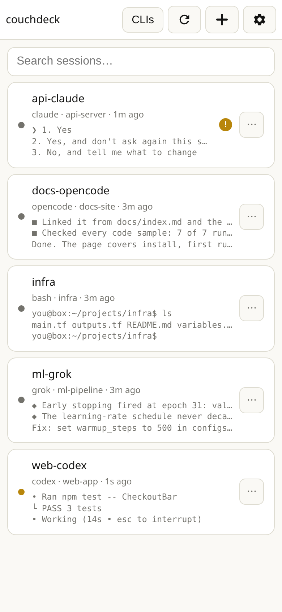
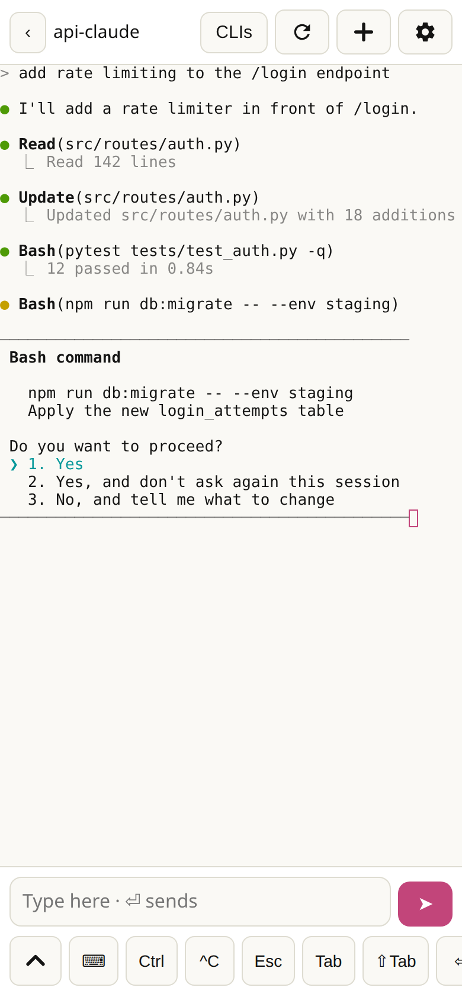
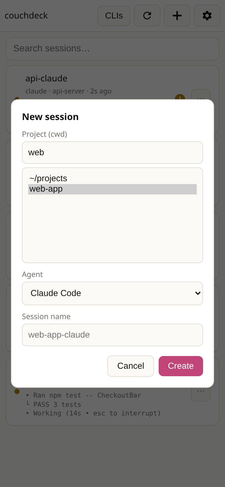

# couchdeck

A phone-friendly web terminal for the tmux sessions already running on your
machine. Open it in a mobile browser, see every session as a card, tap one to
attach, and start a new coding agent (Claude Code, Codex, opencode, grok,
Antigravity, or a plain shell) in any project folder without typing a command
line on a phone keyboard.

It is built for one person reaching their own box over a private network such
as [Tailscale](https://tailscale.com). **It has no login.** Anyone who can
reach the page gets a shell as the user running it. Read [Security](#security)
before you expose it anywhere.

<!-- Screenshots: replace these placeholders before publishing. -->
| Deck | Attached | New session |
|---|---|---|
|  |  |  |

## What it does

- **The deck is your real tmux sessions**, the same ones `tmux ls` shows. Each
  card shows the running command, the project folder, how long since the last
  output, and the last few meaningful lines of the pane, so a waiting
  permission prompt is readable without attaching.
  - Green dot: a client is attached now. Amber: nobody attached, but output in
    the last 60 seconds (an agent still working). Grey: quiet.
- **Tap a card to attach.** A full interactive terminal (xterm.js over a PTY
  running `tmux attach`), so agent TUIs, colours and keys work.
- **＋ starts an agent**: pick a folder under `PROJECTS_ROOT`, pick a launcher,
  and (for opencode) a model read live from your opencode config.
- **Built for phones**: a key bar (Ctrl, ^C, Esc, Tab, arrows, paste, hide
  keyboard), a compose bar that works around Android IME quirks, swipe to
  scroll, automatic reconnect when the phone switches networks, light and dark
  themes, and an installable PWA manifest.
- **Search** the deck by session name, command or path.
- **Nothing is killed when you leave.** Going back to the deck just detaches;
  tmux keeps the work.

## Requirements

- Linux with `tmux` 3.2 or newer (macOS may work but is untested)
- Python 3.10 or newer (tested on 3.12)
- A private network between your phone and the machine. Tailscale is the
  tested setup; the app recognises its MagicDNS name automatically.
- Optional: the agent CLIs you want to launch (`claude`, `codex`, `opencode`,
  `grok`, `agy`). Launchers for missing tools just fail in the new pane.

## Install

```bash
git clone https://github.com/OWNER/couchdeck.git ~/couchdeck
cd ~/couchdeck
python3 -m venv venv
./venv/bin/pip install -r requirements.txt
cp .env.example .env
```

## Quickstart

Bind to your Tailscale address and start it:

```bash
cd ~/couchdeck
sed -i 's/^COUCHDECK_BIND=.*/COUCHDECK_BIND=tailscale/' .env
./scripts/run.sh
```

Then open `http://<your-tailscale-ip>:3320` on your phone. To try it on the
same machine first, leave `COUCHDECK_BIND=127.0.0.1` and open
`http://127.0.0.1:3320`.

### HTTPS (recommended)

Browsers only allow clipboard access and PWA install on a secure origin.
`tailscale serve` gives you a real certificate with no extra config, and lets
the app stay bound to `127.0.0.1`:

```bash
tailscale serve --bg --https=3443 http://127.0.0.1:3320
```

Open `https://<machine>.<tailnet>.ts.net:3443`. Undo with
`tailscale serve --https=3443 off`.

### Run it as a service

```bash
mkdir -p ~/.config/systemd/user
cp ~/couchdeck/contrib/couchdeck.service ~/.config/systemd/user/
systemctl --user daemon-reload
systemctl --user enable --now couchdeck
loginctl enable-linger "$USER"     # keep running after you log out
```

The unit assumes the repo is at `~/couchdeck`; edit its paths if not.

## Configuration

All settings are environment variables, read from `.env` by `scripts/run.sh`.
`.env.example` documents each one. The main ones:

| Variable | Default | Purpose |
|---|---|---|
| `COUCHDECK_BIND` | `127.0.0.1` | Listen address. `tailscale` looks up your Tailscale IPv4. |
| `COUCHDECK_PORT` | `3320` | Listen port. |
| `PROJECTS_ROOT` | `~/projects` | Folders offered when starting a session. |
| `COUCHDECK_LAUNCHERS` | `~/.config/couchdeck/launchers.json` | Your launcher list (below). |
| `COUCHDECK_ALLOW_CUSTOM_CMD` | off | Allow a free-text command instead of launchers only. |
| `COUCHDECK_HOSTS` | none | Extra host names the app answers to (reverse proxy, CNAME). |
| `COUCHDECK_ORIGINS` | none | Extra origins allowed to open the terminal WebSocket. |
| `COUCHDECK_ALLOW_PUBLIC` | off | Allow requests on a public IP. Don't. |

### Launchers

Without a launchers file you get Claude Code, Grok, opencode, Codex,
Antigravity and a plain shell. To replace the list, write
`~/.config/couchdeck/launchers.json`:

```json
[
  {"id": "claude", "label": "Claude Code", "template": "claude"},
  {"id": "opencode", "label": "opencode", "template": "opencode", "models": "opencode"},
  {"id": "work", "label": "Agent (work account)", "template": "my-agent-wrapper",
   "note": "Logs in with the work account."},
  {"id": "shell", "label": "Shell only", "template": ""}
]
```

- `template` is typed into a shell in the new session, so treat this file like
  your `.bashrc`.
- `{name}` in a template becomes the session name.
- `"models": "opencode"` adds a model picker filled from
  `~/.config/opencode/opencode.json[c]`; the choice is appended as
  `--model <id>`, shell-quoted.
- `note` appears under **Your launchers** in the in-app CLI guide.
- The file is re-read on every request; a broken file logs a warning and falls
  back to the defaults.

### tmux and shell tips

- Truecolor in the browser needs this in `~/.tmux.conf`:
  `set -as terminal-features ",xterm-256color:RGB"`
- Sessions started by couchdeck carry `COUCHDECK_SESSION=1`. If your shell
  renames tmux sessions from a prompt hook, skip it when that variable is set,
  or the phone will lose track of the session it just created.
- Attaching from the phone detaches other clients of that session (`tmux attach
  -d`), because a tmux window has one size and a wider desktop client would
  leave the phone with a clipped view. Your desktop terminal can reattach any
  time.

## Security

couchdeck hands out a shell and has no authentication. Its security boundary is
the network: only run it where every device that can reach the port is yours.

What it does to keep that boundary honest:

- Refuses requests that arrive on a publicly routable address unless
  `COUCHDECK_ALLOW_PUBLIC=1`, so `--host 0.0.0.0` on a VPS does not give a shell
  to the internet.
- Accepts only known host names (IP literals, `localhost`, the machine's
  hostname, its Tailscale MagicDNS name, `COUCHDECK_HOSTS`), which blocks DNS
  rebinding.
- Checks `Origin` on the WebSocket and on every write, so a web page you visit
  cannot drive the terminal.
- Serves the page with a per-response CSP nonce, `frame-ancestors 'none'` and
  `nosniff`; treats session names and pane text as untrusted.
- Validates session names against an allowlist and shell-quotes model ids.

Known gap: no rate limiting. To report a vulnerability, see
[SECURITY.md](SECURITY.md).

## Development

```bash
./venv/bin/python -m pytest tests/ -q
```

The tests drive a real tmux server and assert on pane contents, not just HTTP
status codes. See [CONTRIBUTING.md](CONTRIBUTING.md).

## License

[MIT](LICENSE). Vendored xterm.js files are MIT-licensed by their authors; see
[THIRD_PARTY_NOTICES.md](THIRD_PARTY_NOTICES.md).
